# KhoMini — Flowchart các luồng chức năng

Đối chiếu mã nguồn ngày 02/11/2026. Sơ đồ ở mức nghiệp vụ phục vụ demo; các thao tác vẫn chịu kiểm tra quyền, trạng thái và phạm vi ở backend. Nhánh lỗi kết thúc lần thao tác hiện tại; người dùng có thể sửa dữ liệu để thực hiện lại. Các dòng sau trong một sơ đồ có thể mô tả lựa chọn liên quan, không có nghĩa mọi lựa chọn đều bắt buộc.

Lưu ý: hộp thoại vô hiệu hóa là bước xác nhận trên giao diện; không biểu thị hệ thống đã có cơ chế chặn tự vô hiệu hóa. Khóa thông minh hiện là mô phỏng. Hoàn trả tiền và trả kho là hai quy trình riêng.

## 01. Vòng đời thuê kho

Nhóm: Tổng quan

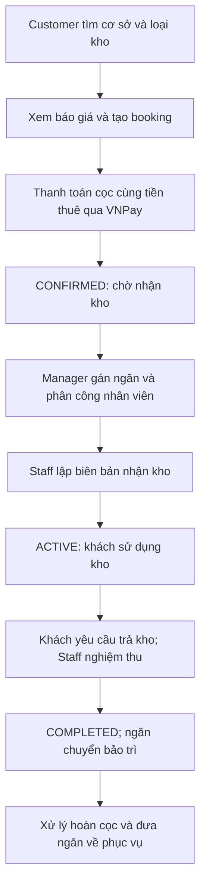

## 02. Đăng nhập và điều hướng vai trò

Nhóm: Tài khoản

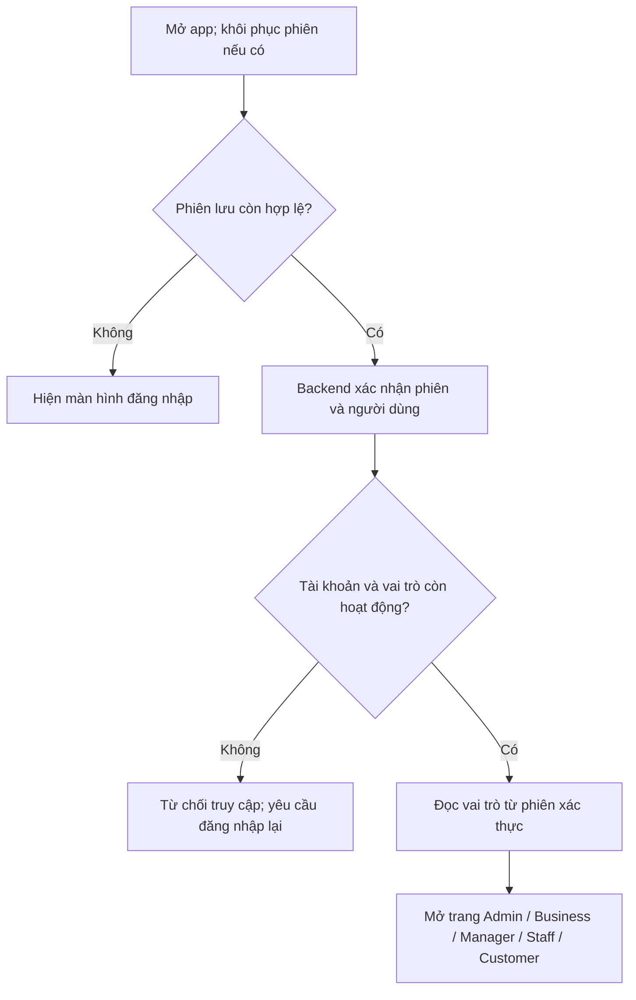

## 03. Đăng ký và đăng nhập mới

Nhóm: Tài khoản

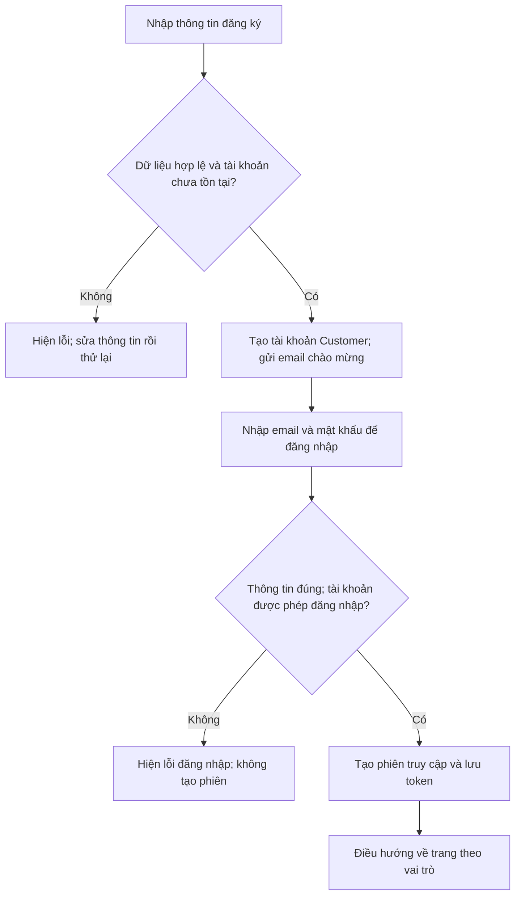

## 04. Quên mật khẩu và đổi mật khẩu

Nhóm: Tài khoản

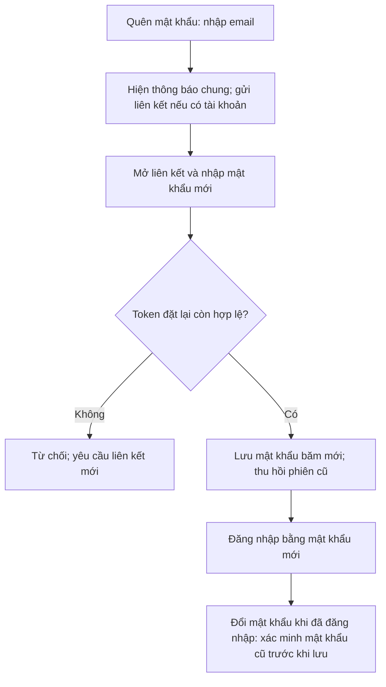

## 05. Phiên đăng nhập, hồ sơ và đăng xuất

Nhóm: Tài khoản

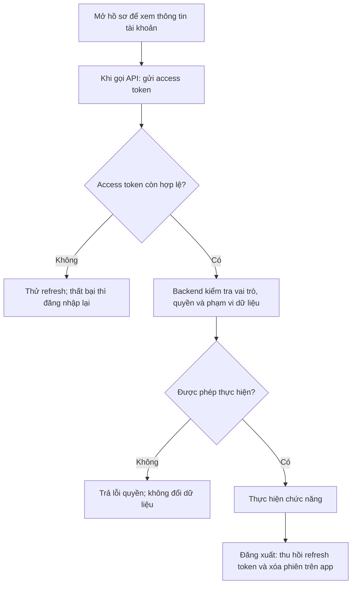

## 06. Tạo tài khoản và gán vai trò

Nhóm: Admin

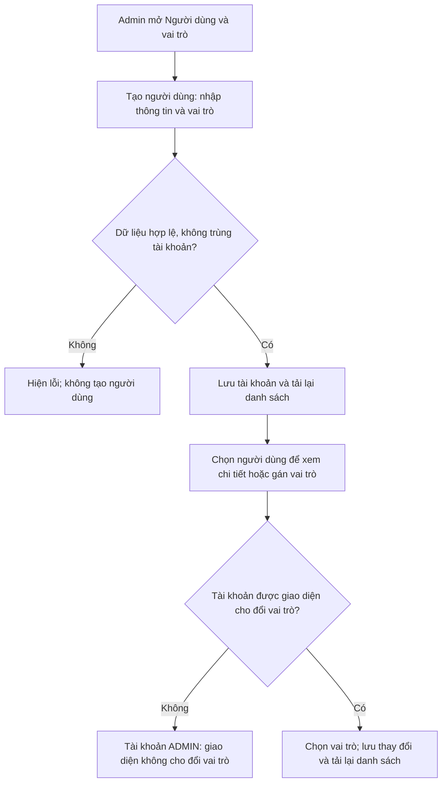

## 07. Vô hiệu hóa, kích hoạt và xóa tài khoản

Nhóm: Admin

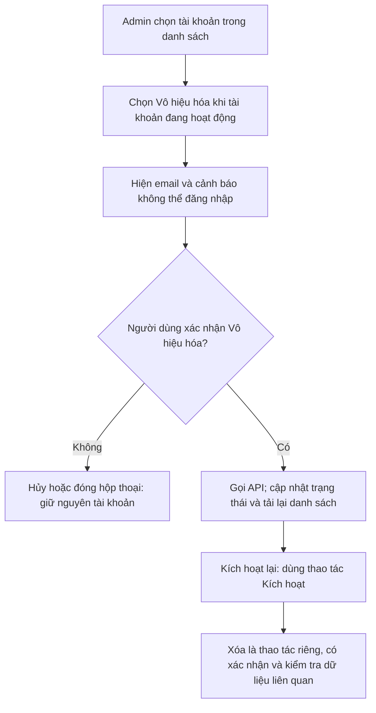

## 08. Phân quyền vai trò

Nhóm: Admin

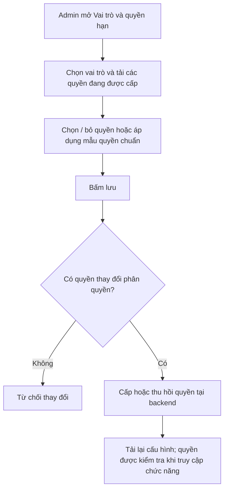

## 09. Gán quản lý cơ sở

Nhóm: Admin

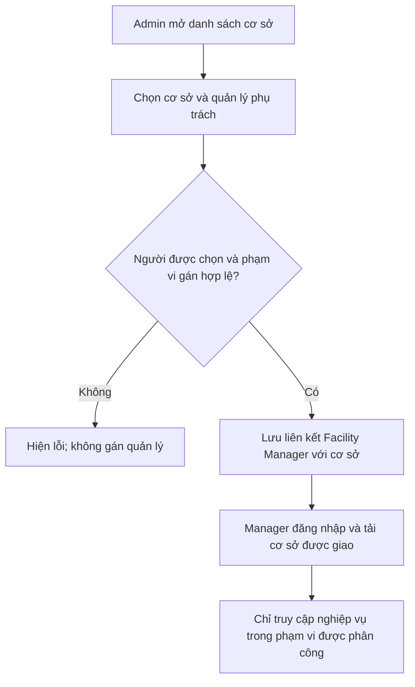

## 10. Tạo và sửa cơ sở có hình ảnh

Nhóm: Business

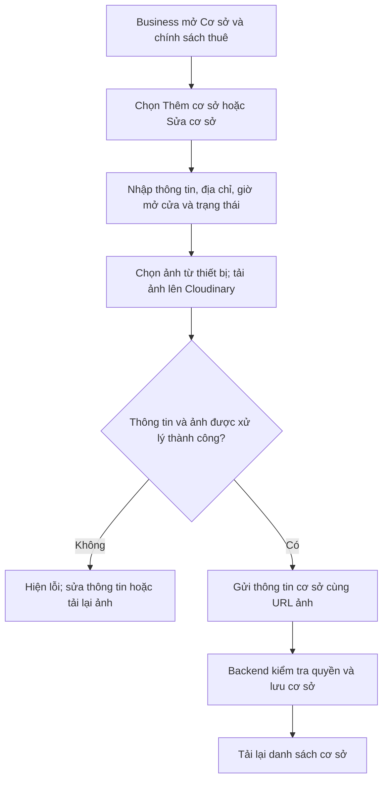

## 11. Chính sách thuê và giá loại kho

Nhóm: Business

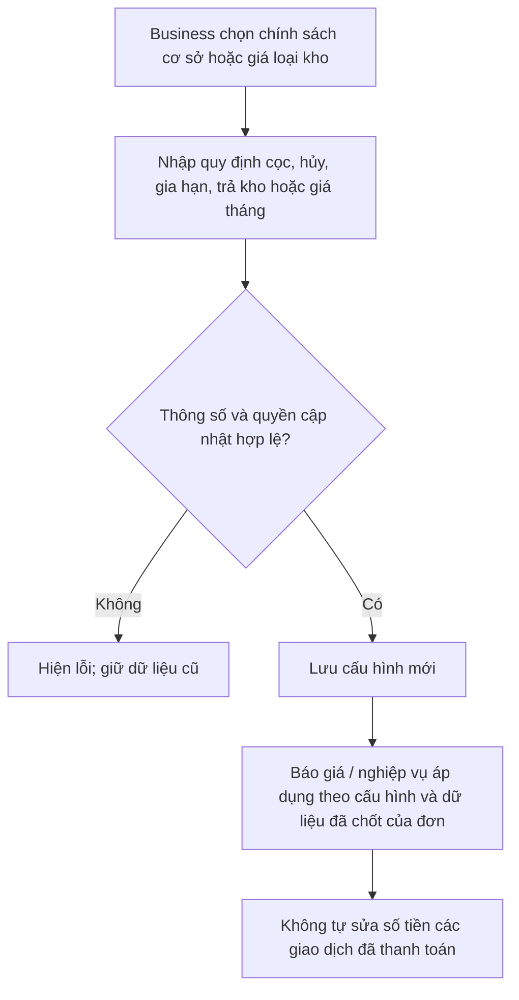

## 12. Quản lý ngăn kho và bảo trì

Nhóm: Manager

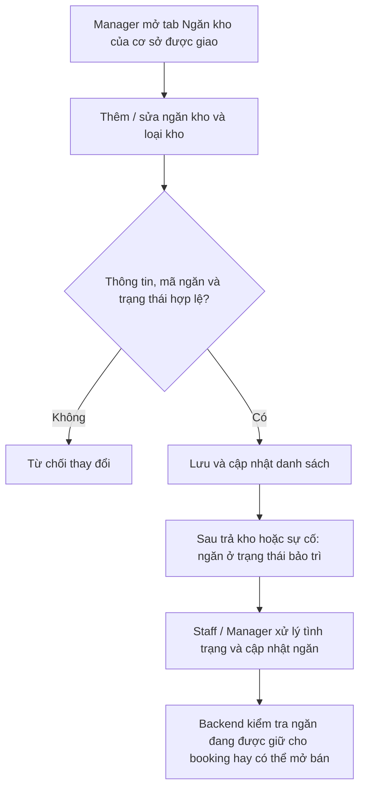

## 13. Gán nhân viên và lịch bàn giao

Nhóm: Manager

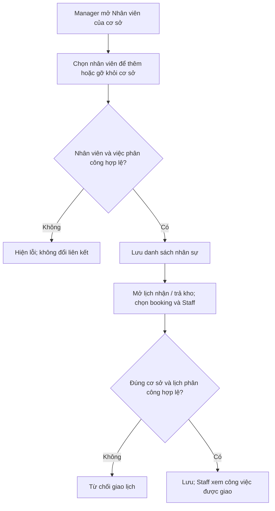

## 14. Tìm kho, báo giá và danh sách chờ

Nhóm: Customer

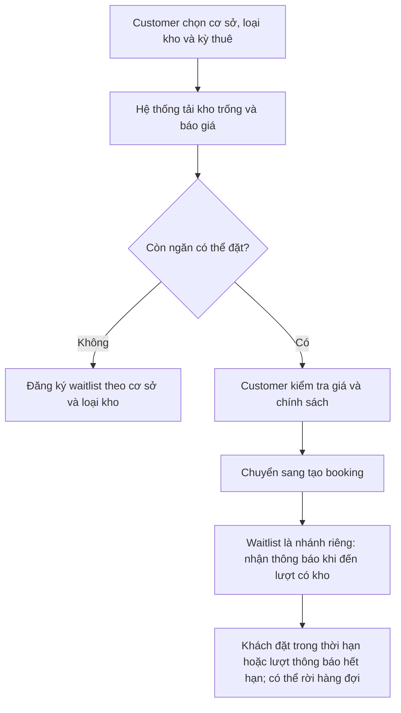

## 15. Đặt chỗ và thanh toán ban đầu

Nhóm: Customer

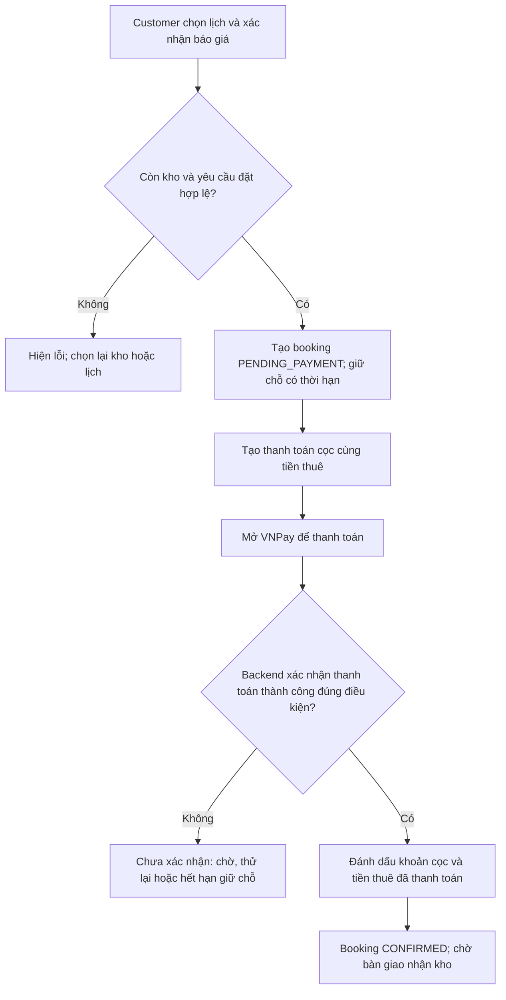

## 16. Xử lý VNPay và đối soát

Nhóm: Thanh toán

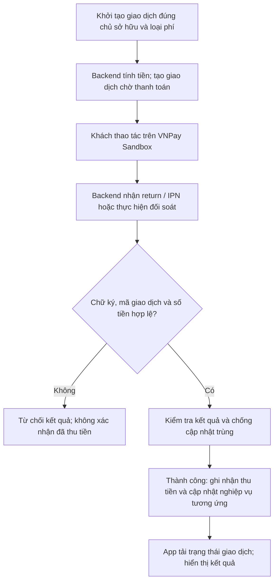

## 17. Hủy booking chưa thanh toán

Nhóm: Customer

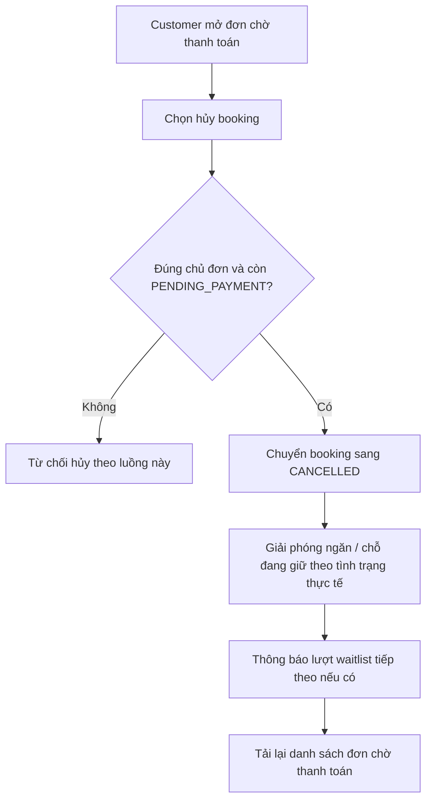

## 18. Gán ngăn và bàn giao nhận kho

Nhóm: Nhận kho

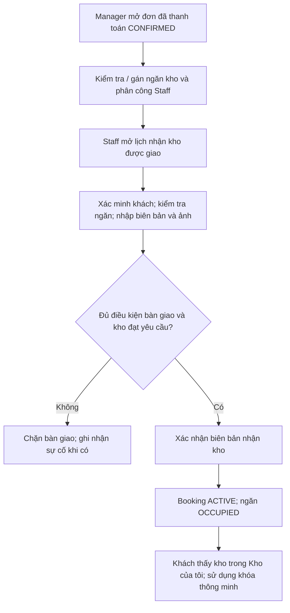

## 19. Sự cố không thể bàn giao

Nhóm: Nhận kho

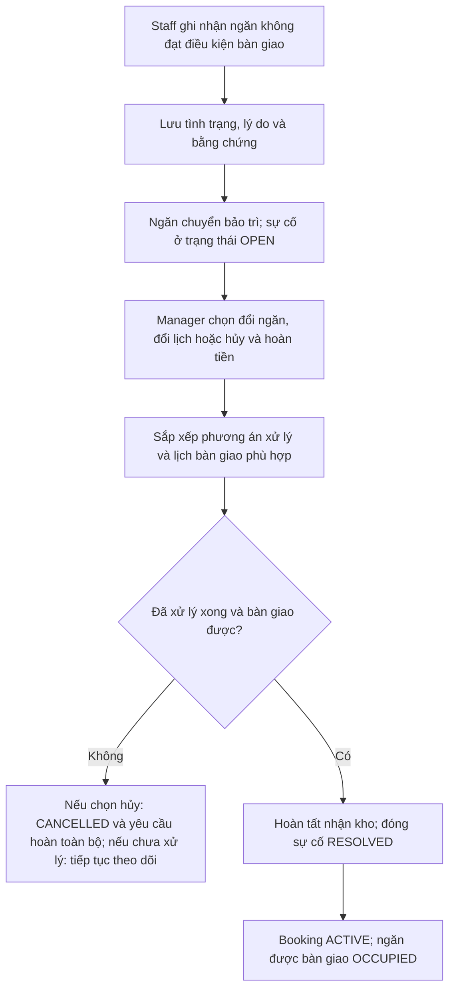

## 20. Khóa thông minh và quên PIN

Nhóm: Sử dụng kho

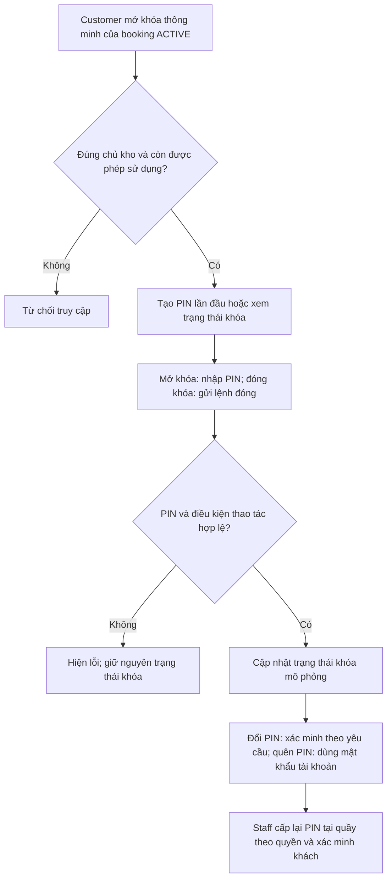

## 21. Mã ra vào cổng

Nhóm: Sử dụng kho

```mermaid
flowchart TD
  N0["Customer yêu cầu mã cổng cho kho ACTIVE"]
  N1["Backend cấp mã có hạn dùng"]
  N0 --> N1
  N2["Khách đưa mã cho Staff / Manager tại cơ sở"]
  N1 --> N2
  N3["Nhân viên gửi mã để xác thực"]
  N2 --> N3
  N4{"Đúng cơ sở, còn hạn, chưa dùng và booking hợp lệ?"}
  N4 -->|Không| E4["Từ chối mã; không cho sử dụng lại"]
  N3 --> N4
  N5["Đánh dấu mã đã sử dụng"]
  N4 -->|Có| N5
  N6["Hiển thị kết quả xác thực; mã chỉ dùng một lần"]
  N5 --> N6
```

## 22. Gia hạn hợp đồng

Nhóm: Sử dụng kho

```mermaid
flowchart TD
  N0["Customer chọn gia hạn booking ACTIVE"]
  N1["Nhập số tháng gia hạn"]
  N0 --> N1
  N2{"Đúng cửa sổ gia hạn và không còn phí quá hạn phải xử lý?"}
  N2 -->|Không| E2["Hiện lý do; xử lý phí hoặc chờ đến thời điểm được gia hạn"]
  N1 --> N2
  N3["Tính phí; lưu yêu cầu gia hạn chờ thanh toán"]
  N2 -->|Có| N3
  N4["Thanh toán qua VNPay"]
  N3 --> N4
  N5{"Đã xác nhận thanh toán gia hạn thành công?"}
  N5 -->|Không| E5["Tiếp tục thanh toán hoặc hủy yêu cầu đang chờ"]
  N4 --> N5
  N6["Cập nhật ngày kết thúc và tổng thời gian thuê"]
  N5 -->|Có| N6
  N7["Kho tiếp tục ACTIVE với thời hạn mới"]
  N6 --> N7
```

## 23. Đặt lịch và nghiệm thu trả kho

Nhóm: Trả kho

```mermaid
flowchart TD
  N0["Customer chọn trả kho đang ACTIVE"]
  N1["Nhập lịch hẹn và thông tin ngân hàng nhận hoàn tiền"]
  N0 --> N1
  N2{"Đúng giờ mở cửa và thời gian báo trước?"}
  N2 -->|Không| E2["Hiện lỗi; chọn lịch / thông tin khác"]
  N1 --> N2
  N3["Lưu yêu cầu; thông báo Manager để phân công Staff"]
  N2 -->|Có| N3
  N4["Staff kiểm tra kho, chụp ảnh và ghi nhận hư hỏng"]
  N3 --> N4
  N5{"Các khoản nợ và điều kiện trả kho đã được xử lý?"}
  N5 -->|Không| E5["Chặn hoàn tất; xử lý nghĩa vụ còn thiếu"]
  N4 --> N5
  N6["Lập biên bản trả kho; tính khoản cọc được hoàn"]
  N5 -->|Có| N6
  N7["Booking COMPLETED; ngăn UNDER_MAINTENANCE"]
  N6 --> N7
  N8["Mở quy trình hoàn cọc nếu còn số tiền phải hoàn"]
  N7 --> N8
```

## 24. Hoàn tiền cọc và đối soát hoàn tiền

Nhóm: Trả kho

```mermaid
flowchart TD
  N0["Hệ thống tính cọc hoàn sau các khoản khấu trừ hợp lệ"]
  N1{"Còn tiền cần hoàn cho khách?"}
  N1 -->|Không| E1["Ghi nhận cọc đã được khấu trừ hết; không tạo khoản hoàn dương"]
  N0 --> N1
  N2["Tạo yêu cầu hoàn; kiểm tra thông tin giao dịch gốc"]
  N1 -->|Có| N2
  N3["Manager bổ sung dữ liệu / xử lý yêu cầu cần xem xét"]
  N2 --> N3
  N4["Hệ thống gửi hoàn VNPay hoặc theo quy trình chuyển khoản"]
  N3 --> N4
  N5{"Đã có xác nhận hoàn tiền thực tế?"}
  N5 -->|Không| E5["Chờ đối soát; bổ sung thông tin hoặc thử lại theo trạng thái"]
  N4 --> N5
  N6["Ghi nhận COMPLETED; cập nhật dữ liệu giao dịch"]
  N5 -->|Có| N6
  N7["Lịch sử và báo cáo phản ánh khoản hoàn đã xác nhận"]
  N6 --> N7
```

## 25. Quá hạn và niêm phong kho

Nhóm: Vận hành

```mermaid
flowchart TD
  N0["Tác vụ định kỳ kiểm tra booking ACTIVE đã qua ngày kết thúc"]
  N1["Đọc chính sách quá hạn đã chốt; tính số ngày tính phí"]
  N0 --> N1
  N2{"Đã vượt thời gian miễn phí theo chính sách?"}
  N2 -->|Không| E2["Chưa thu phí quá hạn ở thời điểm này"]
  N1 --> N2
  N3["Ghi nhận phí còn phải thanh toán; cập nhật mốc xử lý"]
  N2 -->|Có| N3
  N4["Đến điều kiện niêm phong: xử lý theo chính sách và phê duyệt"]
  N3 --> N4
  N5["Customer thanh toán phí quá hạn theo giao dịch được tạo"]
  N4 --> N5
  N6["Gia hạn / trả kho kiểm tra và tính bổ sung phí còn thiếu trước khi xử lý"]
  N5 --> N6
```

## 26. Gửi và xử lý yêu cầu hỗ trợ

Nhóm: Hỗ trợ

```mermaid
flowchart TD
  N0["Customer chọn kho và nhập nội dung, loại sự cố, ảnh"]
  N1{"Đúng chủ kho và dữ liệu yêu cầu hợp lệ?"}
  N1 -->|Không| E1["Từ chối tạo ticket"]
  N0 --> N1
  N2["Tạo ticket OPEN tại cơ sở tương ứng"]
  N1 -->|Có| N2
  N3["Staff tự nhận hoặc Manager phân công nhân viên"]
  N2 --> N3
  N4["Staff xử lý; trạng thái IN_PROGRESS"]
  N3 --> N4
  N5["Cập nhật kết quả xử lý RESOLVED / CLOSED theo quy tắc"]
  N4 --> N5
  N6["Customer theo dõi trạng thái và chi tiết yêu cầu"]
  N5 --> N6
```

## 27. Báo cáo và lịch sử giao dịch

Nhóm: Giám sát

```mermaid
flowchart TD
  N0["Admin / Business mở báo cáo toàn hệ thống; Manager xem cơ sở được giao"]
  N1["Chọn kỳ báo cáo hoặc bộ lọc lịch sử"]
  N0 --> N1
  N2{"Có quyền và đúng phạm vi dữ liệu?"}
  N2 -->|Không| E2["Từ chối truy cập"]
  N1 --> N2
  N3["Tổng hợp doanh thu, hoàn tiền, cọc và tỷ lệ lấp đầy"]
  N2 -->|Có| N3
  N4{"Truy vấn xử lý thành công?"}
  N4 -->|Không| E4["Hiện lỗi và nút thử lại"]
  N3 --> N4
  N5["Hiển thị số liệu và chi tiết giao dịch theo quyền"]
  N4 -->|Có| N5
  N6["Báo cáo toàn hệ thống: xuất CSV qua thao tác sao chép trên app"]
  N5 --> N6
```

## 28. Thông báo và nhật ký hoạt động

Nhóm: Giám sát

```mermaid
flowchart TD
  N0["Nghiệp vụ phát sinh sự kiện cần thông báo / ghi nhận"]
  N1["Tạo thông báo theo người nhận và nhật ký theo chức năng"]
  N0 --> N1
  N2["Người dùng mở thông báo của mình"]
  N1 --> N2
  N3["Đánh dấu từng thông báo hoặc tất cả là đã đọc"]
  N2 --> N3
  N4["Admin mở Nhật ký hoạt động hoặc Lịch sử đăng nhập"]
  N3 --> N4
  N5{"Có quyền xem nhật ký tương ứng?"}
  N5 -->|Không| E5["Từ chối truy cập"]
  N4 --> N5
  N6["Lọc danh sách; mở chi tiết để xem người thực hiện và nội dung"]
  N5 -->|Có| N6
```

## 29. Đơn hết hạn và waitlist

Nhóm: Tự động

```mermaid
flowchart TD
  N0["Tác vụ nền kiểm tra định kỳ"]
  N1["Booking chưa trả tiền hết hạn: hủy và giải phóng chỗ"]
  N0 --> N1
  N2["Booking đã trả tiền nhưng chưa nhận kho hết điều kiện: xử lý hết hạn"]
  N1 --> N2
  N3["Giải quyết khoản đã thu theo quy tắc hoàn / khấu trừ của nghiệp vụ"]
  N2 --> N3
  N4["Nếu có ngăn phục vụ được: thông báo người chờ tiếp theo"]
  N3 --> N4
  N5["Lượt waitlist được thông báo nhưng hết thời hạn: cập nhật hết hạn"]
  N4 --> N5
  N6["Chuyển lượt và tiếp tục theo dõi trong lần chạy tiếp theo"]
  N5 --> N6
```

## Nguồn đối chiếu

- FE/storehub_mobile/lib/screens: admin, operations, manager, staff, customer, common.
- BE/StoreHub/src/main/java/com/storehub/controller: Auth, User, RolePermission, Facility, FacilityManagement, FacilityOperations, Booking, Payment, CustomerStorage, RefundReview, Report, Waitlist, CustomerTicket, StaffTicket, Notification, ActivityLog.
- Backend service, repository, enums và scheduler tương ứng.
